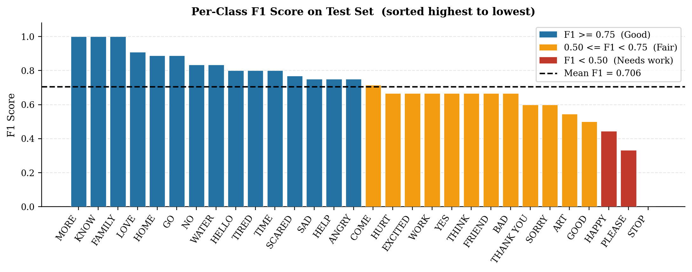
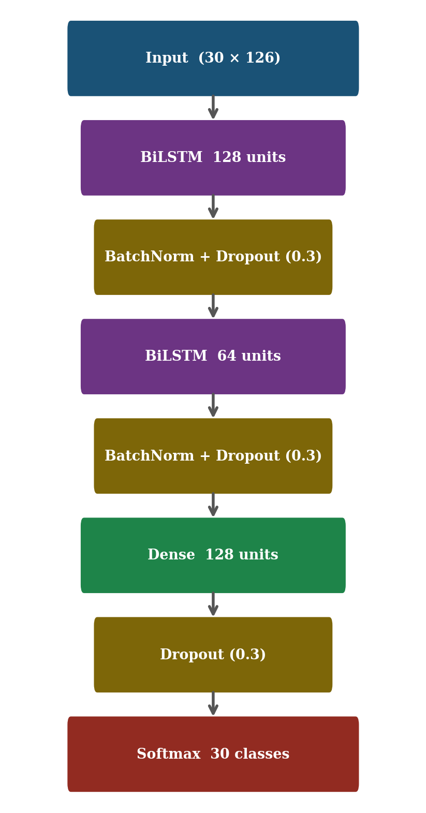

# Real-Time ASL Word Detection


Recognises **30 common American Sign Language (ASL) words** live from an ordinary laptop webcam, with no gloves, depth camera or GPU. Hand landmarks from MediaPipe are fed to a Bidirectional LSTM that reads the motion of a sign over time.

**Team project at Blekinge Institute of Technology (BTH), 2026.** Team: Muhammad Asif Khan (lead developer), Orobosa Igho-Osagie, Syeda Sara Afzaal.


## Results

| Metric | Value |
|---|---|
| Test accuracy | **71.3%** (30 classes, chance is 3.3%) |
| Best validation accuracy | 76.0% |
| Mean F1 score | 0.706 |
| Classes with F1 of 0.75 or more | 15 of 30 |

**Data augmentation made the biggest difference.** With only about 20 training videos per word, augmenting the landmark sequences lifted test accuracy from about 48% to 71%:

| Training data | Sequences | Test accuracy |
|---|---|---|
| Original videos only | 589 | ~48% |
| 5x augmentation | ~2,945 | ~64% |
| **10x augmentation** | **5,890** | **71.3%** |

**Where it struggles:** Most errors come from signs that look alike. KNOW and THINK both place a hand near the forehead, and GO and COME share a hand shape but move in opposite directions. STOP was the hardest class.

| Confusion matrix | Per-class F1 score |
|---|---|
|  |  |

## How it works

1. **Frame sampling:** 30 evenly spaced frames are taken from each clip, so short and long videos give the same input length.
2. **Landmarks:** MediaPipe HandLandmarker finds 21 key points per hand (x, y, z). Two hands give 126 values per frame, so each clip becomes a 30 x 126 sequence.
3. **Augmentation:** Nine coordinate-space transforms (Gaussian noise, horizontal mirroring, scaling, translation and combinations of these) are added to each original sequence, giving 10x the training data. Working on numbers instead of pixels keeps this fast.
4. **Model:** Two stacked Bidirectional LSTM layers (128 and 64 units per direction) with dropout, a dense layer of 128 and a 30-way softmax. Trained with early stopping, finishing after 49 epochs.
5. **Live inference:** A rolling 30-frame window from the webcam, predictions averaged over the last 10 frames and a 70% confidence threshold to avoid flickering output.

<p align="center"></p>

**Vocabulary:** ANGRY, ART, BAD, COME, EXCITED, FAMILY, FRIEND, GO, GOOD, HAPPY, HELLO, HELP, HOME, HURT, KNOW, LOVE, MORE, NO, PLEASE, SAD, SCARED, SORRY, STOP, THANK YOU, THINK, TIME, TIRED, WATER, WORK, YES.

## Quick start

The trained model is included, so live detection works straight away:

```bash
git clone https://github.com/Asif-Khan-01/Sign-Language-Detection.git
cd Sign-Language-Detection
pip install -r requirements.txt
python realtime_asl.py
```

Controls: `A` add the current word to the sentence, `C` clear, `Q` quit.

## Retraining

Download the [akasheroor/American-Sign-Language-Dataset](https://huggingface.co/datasets/akasheroor/American-Sign-Language-Dataset) from Hugging Face (889 clips, 28 to 31 per word) into `data/raw/`, one folder per word, then run the notebooks in order:

| Notebook | Purpose |
|---|---|
| `01_dataset_preprocessing.ipynb` | Explore the videos and make a stratified split (5 test and 5 validation videos per word) |
| `02_landmark_extraction.ipynb` | Extract MediaPipe landmarks and build augmented sequences |
| `03_lstm_training.ipynb` | Build and train the BiLSTM |
| `04_model_evaluation.ipynb` | Confusion matrix, per-class F1 and confidence analysis |
| `05_realtime_detection.ipynb` | Live webcam demo inside Jupyter |

The raw videos and generated arrays are not stored in this repository because of their size (about 900 MB).

## Project structure

```
realtime_asl.py          Standalone real-time detector
hand_landmarker.task     MediaPipe hand landmark model
models/                  Trained BiLSTM (best_lstm_model.keras) and metadata
processed_data/          Class names, label encoder and sequence config
report_figures/          Figures from the project report
01-05_*.ipynb            Data, training and evaluation notebooks
requirements.txt         Python dependencies
```

## Next steps

- More training data, especially for look-alike signs such as KNOW and THINK
- Adding face and body landmarks to separate signs made near the face
- A transformer-based sequence model and a larger vocabulary
- Exporting to TensorFlow Lite for a mobile app
