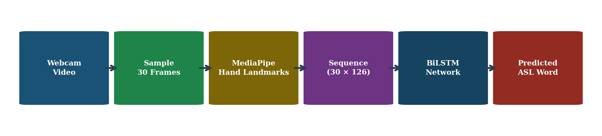
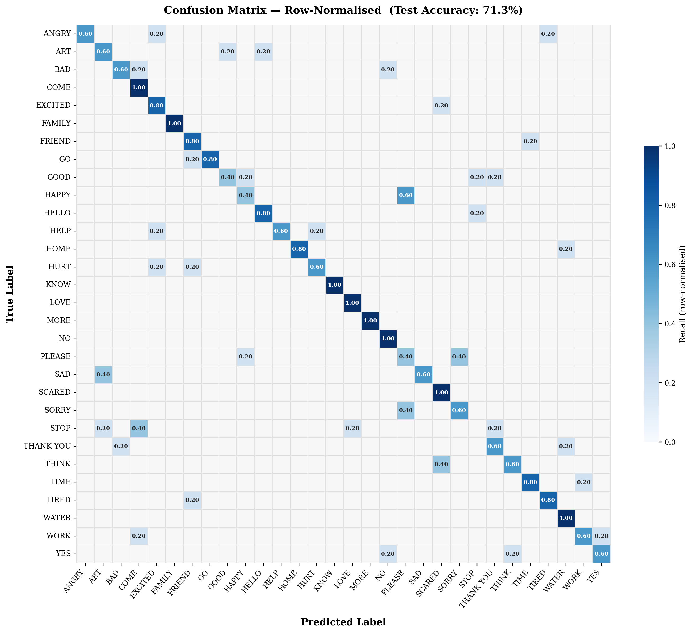

# Real-Time American Sign Language (ASL) Word Detection

Recognises 30 common ASL words from an ordinary webcam in real time, with no special hardware. Built with MediaPipe hand landmarks and a Bidirectional LSTM.

Team project at Blekinge Institute of Technology (BTH), 2026.
**Team:** Muhammad Asif Khan (lead developer), Orobosa Igho-Osagie, Syeda Sara Afzaal.



## Results

| Metric | Value |
|---|---|
| Classes | 30 ASL words |
| Validation accuracy | 76.0% |
| Test accuracy | 71.3% |
| Training data | 589 videos, augmented 10x to 5,890 sequences |



## How it works

1. **Frame sampling:** 30 evenly spaced frames are taken from each video.
2. **Landmark extraction:** MediaPipe HandLandmarker finds 21 key points per hand (x, y, z), giving a (30 x 126) sequence per clip.
3. **Augmentation:** Ten coordinate-space transforms expand the small training set 10x.
4. **Model:** Two-layer Bidirectional LSTM (128 and 64 units per direction) with dropout, a dense layer and a 30-class softmax output.
5. **Real-time inference:** Rolling 30-frame window, predictions averaged over the last 10 frames and a 70% confidence threshold to reduce flicker.

Vocabulary: ANGRY, ART, BAD, COME, EXCITED, FAMILY, FRIEND, GO, GOOD, HAPPY, HELLO, HELP, HOME, HURT, KNOW, LOVE, MORE, NO, PLEASE, SAD, SCARED, SORRY, STOP, THANK YOU, THINK, TIME, TIRED, WATER, WORK, YES.

## Dataset

[akasheroor/American-Sign-Language-Dataset](https://huggingface.co/datasets/akasheroor/American-Sign-Language-Dataset) on Hugging Face: 889 short video clips across 30 classes (28 to 31 per class). Split per class: 5 test videos, 5 validation videos and the rest for training.

The raw videos and processed arrays are not included in this repository because of their size. To retrain, download the dataset into `data/raw/` (one folder per word), then run notebooks 01 and 02 to rebuild the arrays. The trained model is included, so `realtime_asl.py` works without retraining.

## Project structure

```
01_dataset_preprocessing.ipynb   Load videos, explore classes, stratified split
02_landmark_extraction.ipynb     MediaPipe landmarks, (30, 126) sequences, augmentation
03_lstm_training.ipynb           Build and train the BiLSTM
04_model_evaluation.ipynb        Confusion matrix, per-class F1, confidence analysis
05_realtime_detection.ipynb      Live webcam detection
realtime_asl.py                  Standalone real-time detector
hand_landmarker.task             MediaPipe hand landmark model
models/                          Trained model (best_lstm_model.keras) and metadata
processed_data/                  Class names, label encoder, dataset stats
report_figures/                  Figures used in the project report
```

## Quick start

```bash
pip install -r requirements.txt
jupyter notebook          # optional: run notebooks 01 to 04 to retrain
python realtime_asl.py    # live webcam detection with the trained model
```

Controls in the live view: `A` add word to sentence, `C` clear sentence, `Q` quit.

## Tech

Python, TensorFlow/Keras, MediaPipe, OpenCV, scikit-learn, NumPy, Matplotlib.
